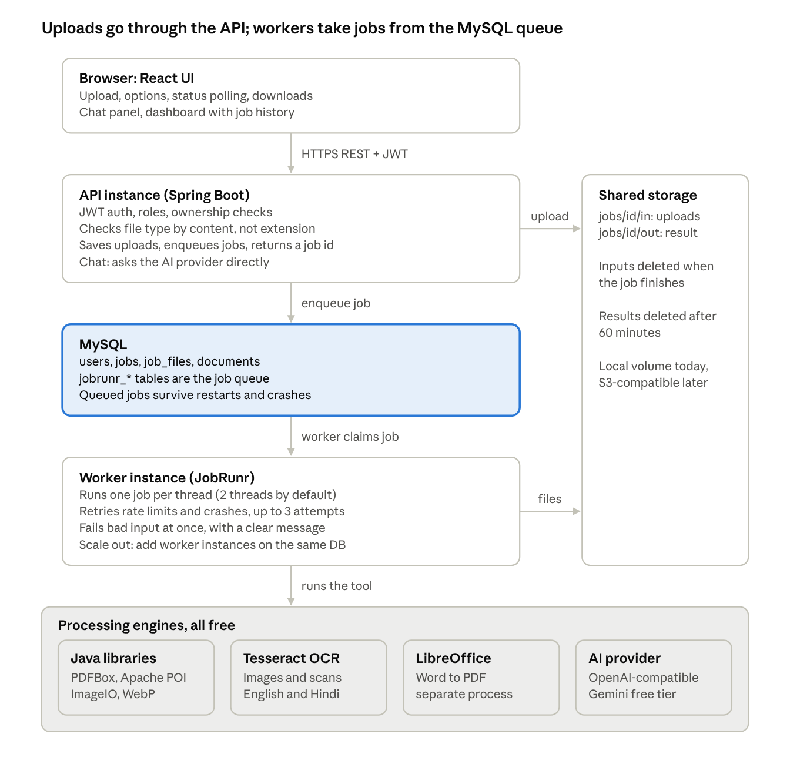
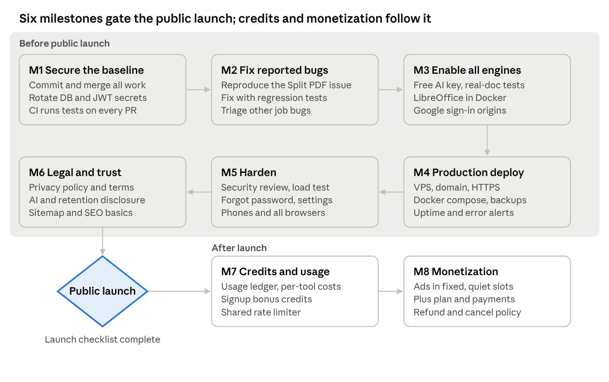
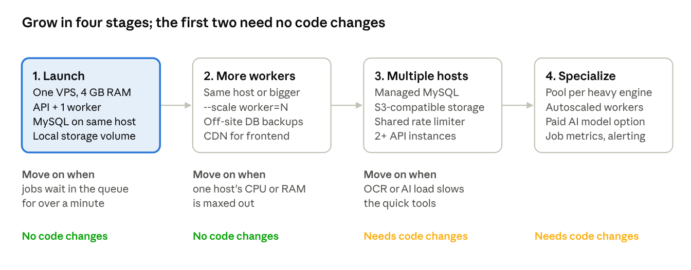

# DocSaaS — Project Status & Launch Roadmap

Last updated: 31 October 2026 · Live, editable version: [Claude doc](https://claude.ai/code/artifact/454ee295-36da-4402-8fec-50289301b9da)

## Executive summary

DocSaaS is feature-complete for its MVP: all 22 tools in the catalogue are built, and 19 run end to end today. The remaining three (AI summary, Document Insights, Chat with PDF) need a free AI key. Credits and profile settings are built too.

What stands between today and a public launch is not features but launch hardening: committing the work, a reported Split PDF bug, real AI-provider testing, production deployment, legal pages, monitoring, and a security review. The plan below covers these in eight milestones (M1 to M8).

- **Built:** React UI (redesigned, glass and 3D), Spring Boot API, JWT auth, guest-first tool flow, JobRunr job engine on MySQL, 15 tool processors, retention cleanup, rate limits.
- **Verified:** 35 backend unit tests, 66 API checks, 68 browser checks, all passing.
- **Not yet done:** nothing is committed to git; Docker files are untested; no production server; no credits system; no legal pages.
- **Budget stance:** every engine is free and open source; the only optional paid items are hosting and, later, a paid AI model.

## Product scope

The MVP scope from the SRS is fully implemented: 22 tools across PDF, image, OCR and AI. Status below is as of today on the development machine.

| Tool | Category | Engine (free) | Status | Notes |
| --- | --- | --- | --- | --- |
| Merge PDF | PDF | Apache PDFBox | Live | 2 to 20 files, user-defined order |
| Split PDF | PDF | Apache PDFBox | Live | Ranges, extract or every page; fixed 31 Oct: missing text on PDFs with inherited fonts, oversized parts from cross-page links |
| Compress PDF | PDF | PDFBox image re-encoding | Live | 60 to 90% on image-heavy PDFs; returns original if no gain |
| PDF to Word | PDF | PDFBox + Apache POI | Live | Keeps headings, bold, images; scanned pages via OCR |
| Word to PDF | PDF | LibreOffice headless | Live | LibreOffice 26.8 installed locally 31 Oct; included in the Docker image |
| PDF to Excel | PDF | PDFBox + Apache POI | Live | One sheet per page; columns rebuilt from layout; numbers kept numeric; simple tables only |
| Rotate PDF | PDF | Apache PDFBox | Live | 90/180/270, all or selected pages, lossless |
| Add Watermark | PDF | Apache PDFBox | Live | Diagonal or horizontal text, 3 strengths; Latin text only |
| Add Page Numbers | PDF | Apache PDFBox | Live | 6 positions, 3 formats, custom start; upright on rotated pages |
| Protect PDF | PDF | Apache PDFBox | Live | AES-256; password removed from the database when the job ends |
| Unlock PDF | PDF | Apache PDFBox | Live | Needs the open password if there is one; removes print/copy restrictions |
| PDF to Images | PDF | PDFBox renderer | Live | PNG or JPG, 72/150/300 DPI, ZIP for many pages |
| Images to PDF | PDF | PDFBox | Live | JPG, PNG, WEBP; A4, Letter or fit |
| Compress Image | Image | Java ImageIO + webp-imageio | Live | Quality and resize options |
| JPG to PNG | Image | Java ImageIO | Live | |
| PNG to JPG | Image | Java ImageIO | Live | Transparency filled white |
| WEBP Converter | Image | webp-imageio | Live | To and from WEBP |
| Image to Text | OCR | Tesseract (Tess4J) | Live | English and Hindi installed |
| Scanned PDF OCR | OCR | Tesseract (Tess4J) | Live | Searchable PDF, up to 50 pages |
| AI PDF Summary | AI | OpenAI-compatible API | Needs AI key | Tested against a mock provider only |
| Document Insights | AI | OpenAI-compatible API | Needs AI key | Key points, dates, names, figures, action items; each quote checked against the page and marked verified or unverified; tested against a mock provider only |
| Chat With PDF | AI | OpenAI-compatible API | Needs AI key | Page citations, keyword retrieval; tested against a mock provider only |

Accounts: email registration and login, JWT sessions (24 h), Google sign-in (blocked by Google Cloud origin setting), job history and dashboard for logged-in users.

## Current architecture

The API never processes files itself: it validates and stores uploads, puts a job in the MySQL-backed JobRunr queue, and workers do the heavy work. This is what makes the system restart-safe and lets it scale by adding workers.

A job flows top to bottom: the browser uploads, the API enqueues, a worker claims the job, runs the engine and writes the result to shared storage; the browser polls status and downloads.

| Layer | Technology | Notes |
| --- | --- | --- |
| Frontend | React 19, Vite, Tailwind v4, Redux Toolkit, RTK Query, framer-motion | JavaScript/JSX as decided; glass and 3D design system |
| Backend | Java 21, Spring Boot 3.5.9, Spring Data JDBC, Spring Security | Package `com.docsaas.api` |
| Job engine | JobRunr OSS 9.0.1 | Queue in MySQL; dashboard on port 8000 |
| Database | MySQL 8 | Tables: users, documents, jobs, job_files, jobrunr_* |
| Storage | Local disk under `STORAGE_DIR` | Server-generated keys, path-traversal protection |
| Security | JWT (24 h), BCrypt, role checks | Guest jobs reachable only by their random id; user jobs only by their owner |

## Completed milestones

SRS Phases 0 to 7 are functionally complete; Phase 8 (launch hardening) has started. Work from 17 October 2026 onward is not yet committed to git.

| Date | Milestone | What was delivered | SRS phase |
| --- | --- | --- | --- |
| 2026-10-18 | All coming-soon tools built | PDF to Word, Word to PDF, Image to Text, Scanned PDF OCR, WEBP converter, AI summary, Chat with PDF; UI wired with chat panel and text viewer | 3, 4, 6 |
| 2026-10-18 | Job engine replaced | JobRunr OSS on MySQL: persistent queue, automatic retries with back-off, API/worker split, dashboard, stuck-job sweeper | 8 |
| 2026-10-18 | Deployment files | Dockerfile with LibreOffice and Tesseract, docker-compose with scalable workers, README (untested build) | 8 |
| 2026-10-17 | UI redesign | Glass and 3D design system, contained layout, tool explorer, dashboard with job history, auth pages, mobile menu | 7 |
| 2026-10-17 | Auth and tools verified | 118 checks across API and browser; fixed image resize bug and stale login toast | 0, 5 |
| 2026-10-17 | Core tool pipeline | Guest-first upload, job, status, download flow; merge, split, compress, PDF/image conversions; retention cleanup; rate limits | 1, 2 |
| 2026-10-17 | Security baseline | Fixed cross-user file download, public user list, leaked error details; secrets moved out of git-tracked config | 0, 8 |
| 2026-06-15 | Homepage | Marketing homepage sections (since replaced by the redesign) | 0 |
| 2026-06-12 | Frontend foundation | React, Vite, Tailwind, Redux, RTK Query, login and register | 5 |
| 2026-06-09 | Backend phase 5 | Documents table and upload API, simulated job endpoints (since replaced) | 1 |
| 2026-01-17 | Authentication | Spring Security, BCrypt, JWT, roles, admin promotion API | 5 |
| 2026-01-15 | Project start | Spring Boot repository, health API | 0 |

## Verification

Every automated suite passes as of 18 October 2026. The browser and API suites live outside the repo and should be committed as part of M1.

| Suite | Checks | Result | Covers |
| --- | --- | --- | --- |
| Backend unit tests (`./mvnw test`) | 35 | 34 pass, 1 skipped | All processors on generated files, OCR, AI with a fake provider, file detection, page ranges; Word to PDF skipped until LibreOffice is installed |
| API end to end | 66 | All pass | Every tool and option, input validation, registration, login, roles, token tampering and expiry, job and document ownership |
| Browser: auth and tools | 52 | All pass | Route guards, register, login, refresh, logout, expired session, every tool through the UI with download checks |
| Browser: new tools | 16 | All pass | OCR text view and copy, searchable PDF, Word export, WEBP, AI summary rendering, chat with citations, unavailable notice |

Verified by hand on the running system:

- Jobs queued with no worker running stay in MySQL and complete when a worker starts.
- An AI call that hits two rate-limit errors is retried and succeeds on the third attempt.
- Expired results are deleted on schedule and downloads then return "expired".
- Pages render without horizontal scroll at 390 px and 1440 px, in light and dark mode.

Not verified yet:

- A real AI provider (only a local mock was used).
- Word to PDF (LibreOffice not installed).
- Google sign-in (blocked by the Google Cloud origin setting).
- The Docker image and compose file (Docker not installed).
- Load and concurrency beyond a single developer machine.

## Known gaps, bugs and risks

The biggest risk today is that everything built since 17 October (the redesign, the job engine, seven new tools) exists only on one laptop, uncommitted. That is fixed first (M1).

| Item | Type | Impact | Fix |
| --- | --- | --- | --- |
| All work since 17 Oct is uncommitted | Risk | Loss of the whole redesign and job engine if the laptop fails | Commit and push to a branch, open a PR (M1) |
| Old DB password and JWT secret are in git history | Security | Anyone with repo access can read them | Rotate both before production (M1) |
| Split PDF misbehaves (founder report) | Bug | Fixed 31 Oct with a regression test; confirm with the founder's own file | Re-test with the original file (M2) |
| AI tested only against a mock | Gap | Prompt, quota or format surprises with a real provider | Add a free Gemini key and run the AI suites (M3) |
| Free AI tiers may train on submitted data | Legal/privacy | Users' documents could leave our control | Choose a provider whose terms fit, disclose it in the privacy policy (M3, M6) |
| LibreOffice not installed locally | Gap | Word to PDF unavailable in development | Install locally or test only in Docker (M3) |
| Google sign-in rejected by Google (origin not allowed) | Config | Google login button fails | Add localhost and production origins in Google Cloud Console (M3) |
| Docker files never built | Gap | Deployment may fail on first try | Build and run on a server (M4) |
| Rate limiter is in memory | Scale | Limits reset on restart and are per instance | Move to MySQL or Redis before running 2+ API instances (Stage 3) |
| Local disk storage | Scale | Workers on other hosts cannot read uploads | Shared volume now; S3-compatible storage later (Stage 3) |
| JobRunr dashboard default password | Security | Job data exposed if the port is open | Set `JOBRUNR_DASHBOARD_PASSWORD`, bind to localhost (M4) |
| Credits recorded, not enforced | Product | Usage is tracked per user, nobody is blocked yet | Set `CREDITS_ENFORCE=true` when ready (M7) |
| No privacy policy, terms or cookie notice | Legal | Draft pages were removed 31 Oct at the founder's request; needed before public launch | Write and publish them (M6) |
| Development machine has under 1 GB free RAM | Ops | Local servers get killed, slow testing | Close heavy apps during work; deploy a cheap server for testing |

## Remaining work

Six milestones stand between today and a public launch; two more follow it. They run in order, because each one depends on the one before (a fix needs committed code, a deploy needs working engines, a launch needs a deploy).

Read the roadmap left to right, then right to left, then down to the launch gate. Steps and the condition that closes each milestone follow.

### M1 Secure the baseline

1. Commit all work on a feature branch, push it and open a pull request into `main`.
2. Rotate the MySQL password and JWT secret; keep them only in environment variables.
3. Move the browser and API test suites into the repo (`docsaas-ui/e2e/`).
4. Add a GitHub Actions workflow: `./mvnw test`, `npm run lint`, `npm run build` on every pull request.

**Done when:** `main` contains all work and CI is green.

### M2 Fix reported bugs

1. Reproduce the Split PDF problem with the founder's own file, mode and page input.
2. Fix it and add a unit test that fails before the fix.
3. Collect any other job bugs the founder has seen, with the same three details, and fix them the same way.

**Done when:** no known bug in any of the 22 tools.

### M3 Enable all engines

1. Get a free Gemini API key and set `AI_API_KEY`; run the summary and chat tests on 5 real documents.
2. Read the provider's data terms; switch provider if free-tier training is not acceptable.
3. Verify Word to PDF inside the Docker image (or install LibreOffice locally) on 5 real DOCX files.
4. Add the development and production origins to the Google OAuth client.

**Done when:** all 22 tools pass on real files.

### M4 Production deploy

1. Choose hosting and buy the domain (see Open decisions).
2. Build the Docker image and run `docker compose up -d` on the server.
3. Put a reverse proxy with free Let's Encrypt HTTPS in front of the API and the built frontend.
4. Set production secrets, CORS origin and the JobRunr dashboard password; keep port 8000 private.
5. Schedule daily MySQL backups and test one restore.
6. Add a free uptime monitor and error alerts to email.

**Done when:** the full site runs on the real domain over HTTPS.

### M5 Harden

1. Security review of auth, uploads, downloads and chat (ownership, limits, injection).
2. Load test: 20 concurrent guests across tools, no errors, no stuck jobs.
3. Account essentials: forgot password by email, profile and password change in Settings.
4. Check every page on real phones and in Chrome, Safari and Firefox.

**Done when:** the Quality and Production parts of the launch checklist are ticked.

### M6 Legal and trust

1. Publish a privacy policy covering file retention, the AI provider and analytics.
2. Publish terms of service and acceptable use.
3. Add a contact email and an About page.
4. Add a sitemap, robots.txt and social preview images for the tool pages.

**Done when:** every launch-checklist box is ticked. This is the public launch gate.

### M7 Credits and usage (after launch)

1. Add `credit_accounts` and `credit_ledger` tables with idempotent entries, as the SRS describes.
2. Set a cost per tool (AI tools cost more) and a signup bonus.
3. Show balance and usage on the dashboard.
4. Move the rate limiter from memory to MySQL or Redis so limits hold across instances.

**Done when:** credit balances are enforced server-side and auditable.

### M8 Monetization (after launch)

1. Ads in fixed slots that never cover upload or download controls, with a consent notice.
2. A Plus plan with clear limits; payments through Razorpay or Stripe.
3. Publish a refund and cancellation policy before taking the first payment.

**Done when:** the first paid subscription works end to end.

## Scalability plan

DocSaaS is built to grow by adding machines rather than rewriting code: the job queue lives in MySQL, so any number of workers can share it. Grow one stage at a time, and only when the signal for that stage appears.

Stages 1 and 2 are configuration only; stage 3 needs the three code changes below, and stage 4 builds on them.

| Change | Needed for | Why | Work |
| --- | --- | --- | --- |
| S3-compatible storage behind `StorageService` | Stage 3 | Workers on other hosts must read uploads and write results | Add an S3 implementation; Cloudflare R2 and MinIO both speak the S3 API |
| Shared rate limiter | Stage 3 | In-memory limits reset on restart and differ per instance | Store hit counts in MySQL or Redis |
| Stateless API behind a load balancer | Stage 3 | Spread requests over 2+ API instances | Already stateless (JWT); add the load balancer and health checks |
| Worker pool per engine | Stage 4 | Long OCR or AI jobs should not delay quick merges | A setting that limits which tools a worker instance runs |
| Job metrics and alerts | Stage 4 | See queue length, failure rate and duration per tool | Enable JobRunr and Spring metrics, send them to a free dashboard |

Guardrails already in place at every stage:

- Hourly limits for guests (30 jobs) and users (200 jobs), and per-hour chat limits.
- File size cap (50 MB), page caps (500 pages, 100 for images and AI, 50 for OCR) and a 50-megapixel image cap.
- LibreOffice limited to 2 parallel conversions per instance, with a 120-second timeout.
- Inputs deleted right after processing and results after 60 minutes, so disk use stays flat.
- AI cost control: about 12,000 characters per chat question and 120,000 per summary call, longer documents summarized in parts.

## Launch checklist

DocSaaS goes public only when every box below is ticked.

**Code and data**

- [ ] All work committed, reviewed and merged to `main`
- [ ] Database password and JWT secret rotated; production secrets only in environment variables
- [ ] Split PDF bug fixed with a regression test
- [ ] Browser and API test suites committed and passing in CI

**Engines**

- [ ] Real AI provider key configured; AI summary and chat tested on 5 real documents
- [ ] Word to PDF tested in the Docker image with 5 real DOCX files
- [ ] OCR tested on 5 real scans (English and Hindi)

**Production**

- [ ] Server running the Docker image behind HTTPS on the real domain
- [ ] CORS set to the production domain only
- [ ] JobRunr dashboard password set and port closed to the internet
- [ ] Daily MySQL backups, with one restore tested
- [ ] Uptime monitor and error alerts going to the founder's email
- [ ] Google sign-in origins set for the production domain

**Legal and trust**

- [ ] Privacy policy, including file retention and AI provider disclosure
- [ ] Terms of service and acceptable use
- [ ] Cookie notice (needed once ads or analytics are added)
- [ ] Contact email that someone reads

**Quality**

- [ ] Every page checked on a real phone and in Safari, Chrome, Firefox
- [ ] Security review of auth, uploads and download access done
- [ ] Load test: 20 concurrent guests run tools without errors

## Open decisions

Five decisions block parts of the roadmap; each has a recommended default so work can continue.

| Decision | Blocks | Options | Recommended default |
| --- | --- | --- | --- |
| AI provider | M3, M6 | Gemini free tier, Groq free tier, OpenRouter free models, paid model later | Start with Gemini free tier; review its data terms before public launch |
| Hosting | M4 | Single VPS (about 4 GB RAM), container platform, free cloud tier | One 4 GB VPS running docker-compose; it fits the whole stack |
| Domain name | M4, M6 | To be chosen | Register before M4 so HTTPS and Google sign-in can be set up |
| Credits and limits | M7 | Credits per tool, daily free quota, or keep hourly limits only | Keep hourly limits for launch; add credits after real usage data |
| Plus plan and payments | M8 | Razorpay, Stripe, none yet | Defer until there are regular users |

Also to confirm: file retention (60 minutes today), maximum file size (50 MB), guest hourly limit (30 jobs), and which OCR languages to install beyond English and Hindi.

## Runbook

The full instructions are in `README.md` at the repository root; this is the short version.

**Run locally** (Java 21+, Node 20+, MySQL 8 with a `docsaas_db` database)

1. Copy `config/application-secrets.example.properties` to `config/application-secrets.properties` and set `DB_PASSWORD` and `JWT_SECRET`.
2. Put `eng.traineddata` and `hin.traineddata` from the tessdata_fast repository into `./tessdata`.
3. Start the backend: `./mvnw spring-boot:run` (API on port 8080, JobRunr dashboard on 8000).
4. Start the frontend: `cd docsaas-ui`, then `npm install` and `npm run dev` (port 5173).

**Key settings** (environment variables override the defaults)

| Variable | Purpose | Default |
| --- | --- | --- |
| `DB_URL`, `DB_USERNAME`, `DB_PASSWORD` | MySQL connection | local `docsaas_db`, user `root` |
| `JWT_SECRET` | Signs login tokens (32+ characters) | none, required |
| `AI_BASE_URL`, `AI_API_KEY`, `AI_MODEL` | AI provider | Gemini OpenAI-compatible endpoint, no key, `gemini-2.5-flash` |
| `LIBREOFFICE_PATH` | Word to PDF engine | auto-detected |
| `TESSDATA_DIR` | OCR language models | `./tessdata` |
| `STORAGE_DIR` | Uploads and results | `./storage` |
| `JOB_WORKER_ENABLED`, `JOB_WORKERS` | Job processing on this instance, threads | `true`, 2 |
| `JOBRUNR_DASHBOARD_PASSWORD` | Dashboard login (user `admin`) | `change-me`, must be changed |
| `CORS_ALLOWED_ORIGINS` | Allowed frontend origin | `http://localhost:5173` |
| `GUEST_JOBS_PER_HOUR`, `USER_JOBS_PER_HOUR` | Rate limits | 30, 200 |
| `RETENTION_MINUTES` | How long results are kept | 60 |
| `CREDITS_ENFORCE`, `CREDITS_SIGNUP_BONUS` | Block jobs the balance cannot cover; welcome credits | `false`, 50 |

**Deploy** (once M4 is done): create a `.env` with the secrets, run `docker compose up -d --build`, and add workers with `docker compose up -d --scale worker=3`.

**Troubleshooting**

- A tool shows "temporarily unavailable": its engine is missing; `GET /api/v1/tools` gives the reason.
- A job stays queued: no instance has `JOB_WORKER_ENABLED=true`, or the worker crashed; check the JobRunr dashboard.
- Servers stop on their own on the development laptop: it is out of memory; close other apps.
